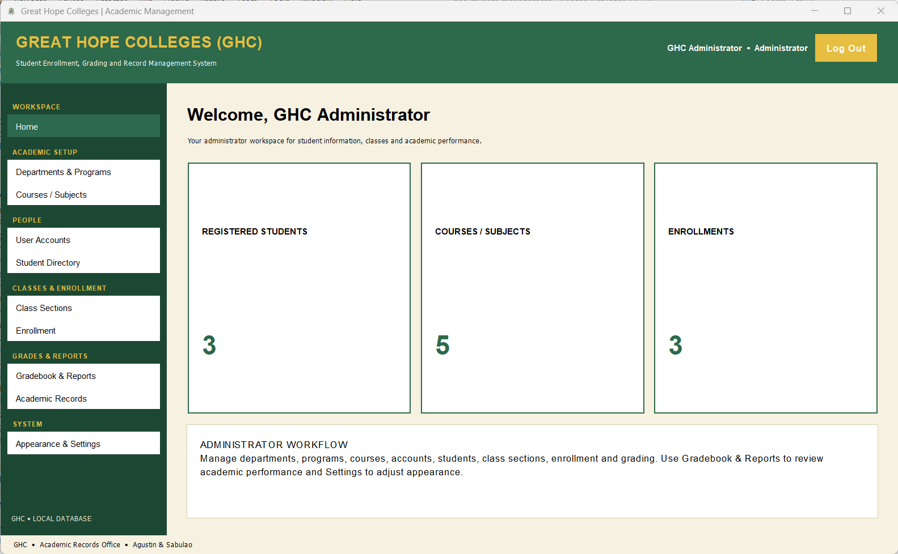
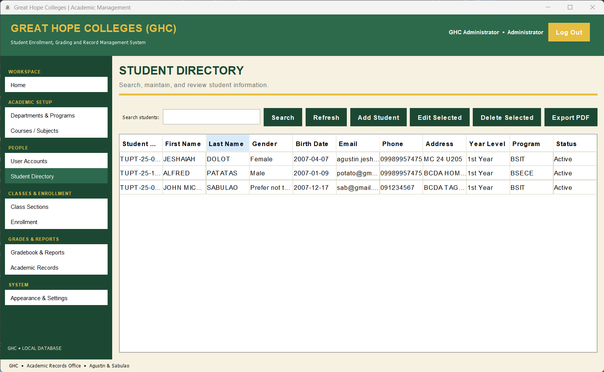
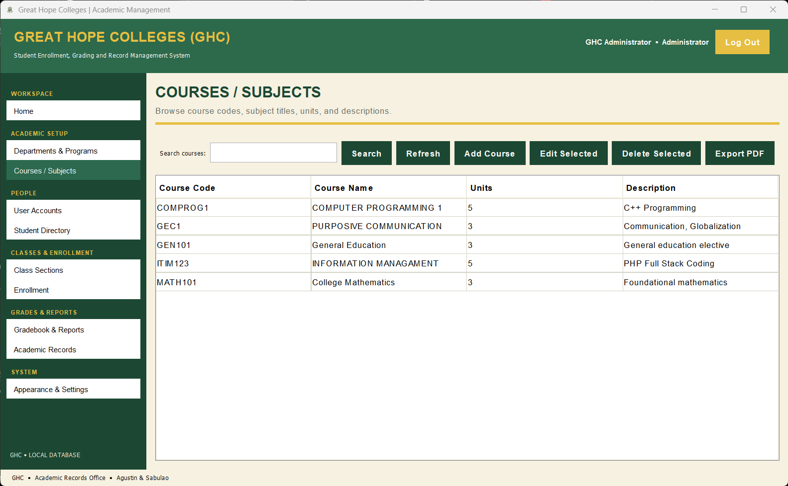
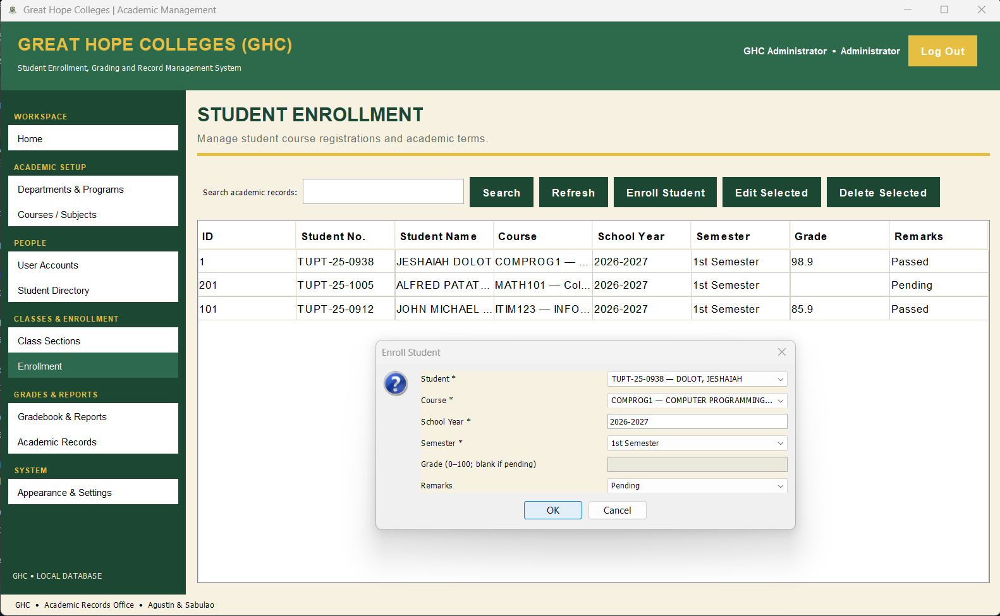
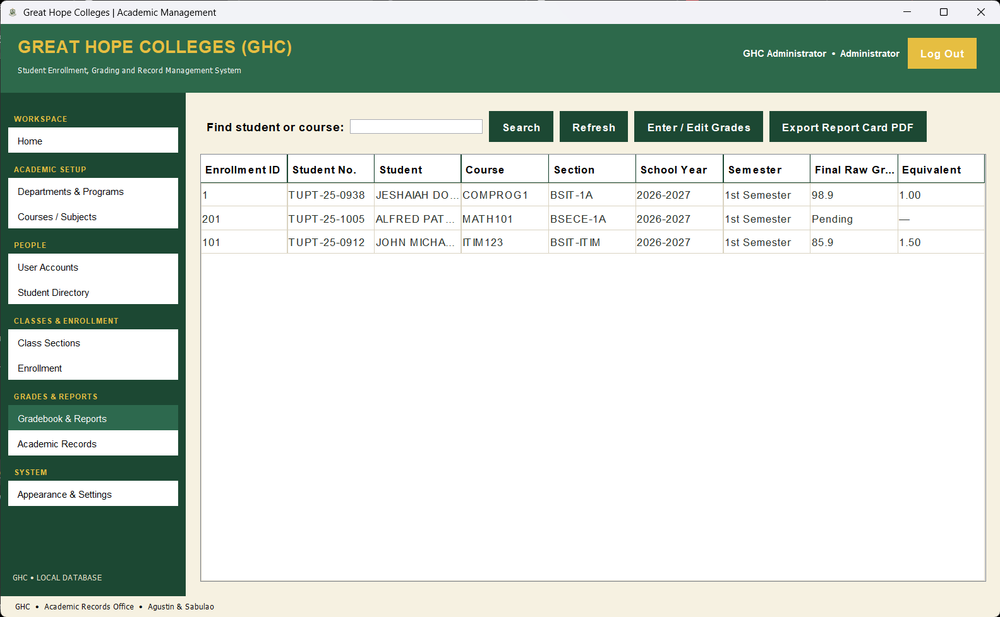

# Great Hope Colleges (GHC)

A Java-based Student Enrollment and Grading Management System for Great Hope Colleges. The application provides a desktop interface for managing student records, courses, enrollment, and academic grading.

## 🖥️ Application Screenshots

### 🔐 Login Screen


### 🏠 Dashboard


### 👨‍🎓 Student Directory


### 📚 Courses and Subjects


### 📝 Enrollment Management


### 📊 Gradebook



---

## 📌 About the Project

Great Hope Colleges (GHC) is a desktop application designed to help manage student and academic records in one system. It uses Java for the application interface and Apache Derby for database storage.

The project is developed using Java Swing/AWT for the graphical user interface, JDBC for database connectivity, and Maven for project management.

## ✨ Features

- **User Login** — Provides a login interface for accessing the application.
- **Dashboard** — Main navigation interface for the system.
- **Student Management** — Organize and manage student records.
- **Course Management** — Manage available courses and subjects.
- **Enrollment Management** — Maintain student enrollment records.
- **Academic Grading** — Record and manage student grades.
- **Database Integration** — Store and retrieve application data using Apache Derby.
- **Role-Based Access** — Supports access based on configured user roles, where implemented.
- **Grade History/Audit** — Database structures support grade audit records, where implemented.

*The availability of each feature depends on the functionality implemented in the current version of the application.*

## 🛠️ Technologies Used

| Technology | Purpose |
|---|---|
| Java 17 | Main programming language |
| Java Swing / AWT | Desktop graphical user interface |
| Apache Maven | Project build and dependency management |
| Apache Derby | Relational database |
| JDBC | Database connectivity |
| NetBeans IDE | Recommended development environment |

## 📋 Requirements

Before running the project, make sure you have:

- Java Development Kit (JDK) 17 or compatible configured version
- Apache Maven
- NetBeans IDE or another Java IDE
- The project source code and required dependencies

## 🚀 Getting Started

### 1. Clone the repository

Open a terminal and run:

```bash
git clone https://github.com/47yarch/Great-Hope-Colleges-GHC-.git
```

Navigate into the project directory:

```bash
cd Great-Hope-Colleges-GHC-
```

### 2. Open the project

**Using NetBeans:**

1. Open NetBeans.
2. Select **File → Open Project**.
3. Select the cloned `Great-Hope-Colleges-GHC-` folder.
4. Wait for Maven to resolve the project dependencies.

### 3. Build the project

From the project directory, run:

```bash
mvn clean compile
```

To package the project:

```bash
mvn clean package
```

### 4. Run the application

Run the project using the configured main class in your IDE. If your project is configured to use Maven's `exec` plugin, use its configured run command.

The application initializes its database through the project's database initialization code when configured to do so.

> **Important:** Use the correct database configuration for your environment. If the application uses an embedded Derby database, make sure the database path is accessible and that the required Derby dependencies are available.

## 🗄️ Database

The application uses **Apache Derby** as its relational database and JDBC to connect Java code to the database.

The database initialization code is responsible for creating or updating the tables required by the application and may insert initial records when configured.

Database tables in the project may include:

- `USERS`
- `STUDENTS`
- `COURSES`
- `ENROLLMENTS`
- `DEPARTMENTS`
- `PROGRAMS`
- `CLASS_SECTIONS`
- `SECTION_SCHEDULES`
- `GRADE_COMPONENTS`
- `GRADE_AUDIT`
- `APP_SETTINGS`

The exact schema depends on the version of the source code being used.

### Sharing the project with another developer

If another developer needs the existing database records:

1. Identify the Derby database location from the JDBC URL in the database connection class.
2. Determine whether the database is embedded and stored locally or configured elsewhere.
3. Back up the database before transferring it.
4. Share a consistent database backup or export through an appropriate private channel.
5. Ensure the other developer's database configuration points to the correct local database location.

**Do not commit database files containing real student information, grades, passwords, or other sensitive data to a public GitHub repository.** Use sample or test data for public demonstrations.

## 📁 Project Structure

The project follows a Maven-style Java directory structure. The exact folders may vary as the project develops.

```text
Great-Hope-Colleges-GHC-/
├── src/
│   └── main/
│       ├── java/
│       │   └── com/
│       │       └── ghc/
│       │           ├── database/
│       │           └── ui/
│       └── resources/
├── docs/
│   └── screenshots/
│       ├── login.png
│       ├── dashboard.png
│       ├── students.png
│       ├── courses.png
│       ├── enrollment.png
│       └── gradebook.png
├── pom.xml
└── README.md
```

This is a guide to the expected layout, not a guarantee that every listed file or directory already exists in the repository.

## 🔒 Security and Privacy

- Do not commit database credentials, passwords, or private configuration values.
- Avoid uploading screenshots containing real student details or grades.
- Use fictional or anonymized records for screenshots and demonstrations.
- Do not publish a database backup containing confidential information.
- Review the repository before making it public.

## 🧰 Troubleshooting

### Maven build fails

Verify that JDK 17 is installed and that Maven is using the correct Java version. Then run:

```bash
mvn clean compile
```

### Database connection fails

- Check the JDBC URL and database location.
- Verify that the Derby dependencies are available.
- Confirm that the application has permission to access the database directory.
- Check the console output for the specific database error.

### Screenshots do not appear on GitHub

- Verify that the images are committed to the repository.
- Check that the paths and capitalization match the README exactly.
- Use repository-relative paths, such as `docs/screenshots/login.png`.
- Confirm that the image files are valid PNG files.

## 🔮 Possible Future Improvements

- Improved validation and error messages
- More detailed reports and printable summaries
- Enhanced role and permission management
- Additional search and filtering options
- Database backup and restore tools
- Improved user interface and accessibility

These are potential improvements and are not necessarily implemented in the current version.

## 👥 Contributors

- **Agustin, Jeshaiah D.**
- **Sabulao, John Michael P.**

## 📄 License

No license has been specified yet. Unless a license is added to the repository, others should not assume they have permission to redistribute or reuse the project.

---

**Great Hope Colleges (GHC)**  
*Student Enrollment and Grading Management System*
