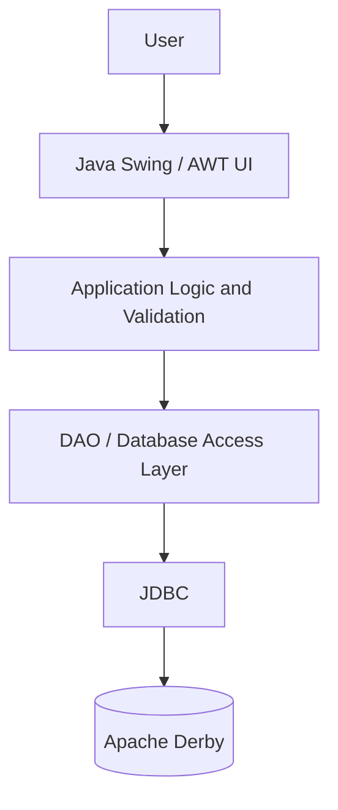
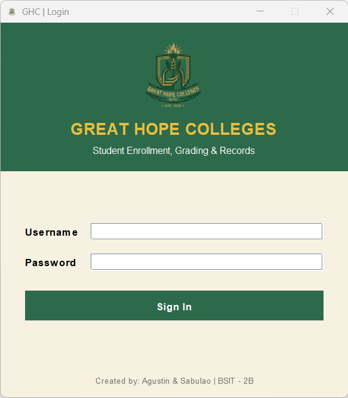

# Great Hope Colleges (GHC)

[](https://www.java.com/)
[](https://docs.oracle.com/javase/tutorial/uiswing/)
[](https://maven.apache.org/)
[](https://db.apache.org/derby/)
[](https://www.java.com/)

> A Java desktop application for managing student records, courses, class sections, enrollment requests, registration status, and academic grades at Great Hope Colleges.

## Table of Contents

- [Overview](#overview)
- [Features](#features)
- [Technology Stack](#technology-stack)
- [Application Architecture](#application-architecture)
- [Database](#database)
- [Requirements](#requirements)
- [Getting Started](#getting-started)
- [Student Portal Workflow](#student-portal-workflow)
- [Project Structure](#project-structure)
- [Security and Privacy](#security-and-privacy)
- [Troubleshooting](#troubleshooting)
- [Contributors](#contributors)
- [License](#license)

## Overview

Great Hope Colleges (GHC) is a desktop-based Student Enrollment and Grading Management System built with Java Swing/AWT. The application uses JDBC to communicate with an Apache Derby database and Maven to manage the project build.

The system provides staff-facing tools for managing academic records and a student portal for viewing available class sections, requesting enrollment, checking registration status, and accessing a grade report.

## Features

- **Login and user accounts** — Sign in using an application account.
- **Role-based access control** — Restrict available actions according to the signed-in user's role.
- **Dashboard** — Navigate the system's main modules.
- **Student management** — Maintain student information and records.
- **Course management** — Manage course and subject information.
- **Class sections** — View and manage class offerings.
- **Enrollment management** — Review enrollment requests and registration records.
- **Student portal** — Students can view available sections and submit enrollment requests.
- **Registration status** — Students can check the status of their enrollment requests.
- **Grade reporting** — Students can access a PDF grade report when the report workflow is available.
- **Academic grading** — Staff can manage grades through the grading module.
- **Derby database integration** — Store and retrieve application data through JDBC.

> Features and permissions may depend on the current source-code version and the account role.

## Technology Stack

| Technology | Purpose |
|---|---|
| Java (project configured for Java 21) | Main programming language |
| Java Swing / AWT | Desktop user interface |
| Apache Maven | Build and dependency management |
| JDBC | Database connectivity |
| Apache Derby | Relational database |
| NetBeans IDE | Recommended development environment |

## Application Architecture

The application follows a typical desktop application flow:



- **UI layer:** Displays screens and collects user input.
- **Application logic:** Coordinates workflows and validates actions.
- **DAO layer:** Performs database queries and updates.
- **Database:** Stores application accounts and academic records.

This is a logical overview; implementation details may vary by module.

## Database

The application uses Apache Derby. The database initialization and data-access classes define the schema and database operations used by the application.

Tables used by the project may include:

- `USERS`
- `STUDENTS`
- `COURSES`
- `CLASS_SECTIONS`
- `ENROLLMENTS`
- `DEPARTMENTS`
- `PROGRAMS`
- `SECTION_SCHEDULES`
- `GRADE_COMPONENTS`
- `GRADE_AUDIT`
- `APP_SETTINGS`

The exact schema depends on the current code version. Check `DatabaseInitializer.java` and the DAO classes for the authoritative table definitions and queries.

### Database safety

- Back up the database before making schema changes or migrating data.
- Do not commit database files containing real student information, grades, or account data to a public repository.
- Use fictional or anonymized records for screenshots and demonstrations.

## Requirements

Before building the project, install:

- **JDK 21** (or the Java version configured in `pom.xml`)
- **Apache Maven** compatible with the project
- **NetBeans IDE** or another Java IDE
- The project source code and Maven dependencies

Check the `pom.xml` if you need to confirm the configured Java version and dependencies.

## Getting Started

### 1. Clone the repository

```bash
git clone https://github.com/47yarch/Great-Hope-Colleges-GHC-.git
cd Great-Hope-Colleges-GHC-
```

### 2. Open the project

In NetBeans:

1. Select **File → Open Project**.
2. Choose the cloned project folder.
3. Wait for Maven to load the project and resolve dependencies.

You can also open the folder in another Java IDE that supports Maven projects.

### 3. Build the project

From the directory containing `pom.xml`, run:

```bash
mvn clean compile
```

To build the packaged project:

```bash
mvn clean package
```

### 4. Run the application

Run the project using its configured main class in NetBeans or your IDE. If a Maven run plugin is configured, use the command documented in `pom.xml`.

The application may initialize or update its database during startup, depending on the database initialization code and configuration.

> **Note:** The database location and any initial account setup depend on the project's configuration. Check the database initializer and login-related classes for the current behavior.

## Student Portal Workflow

For a student account, the portal provides the following workflows:

1. View available class sections.
2. Select a section and request enrollment.
3. Refresh the registration status to check the request state.
4. Access the grade-report PDF workflow, when grades and report data are available.

Enrollment requests may require review by an authorized staff member. Availability, capacity, and duplicate-enrollment checks are handled by the application.

## Project Structure

The project uses a Maven-style directory layout. The following is a simplified overview; exact files and folders may differ:

```text
Great-Hope-Colleges-GHC-/
├── src/
│   └── main/
│       ├── java/
│       │   └── com/
│       │       └── ghc/
│       │           ├── dao/
│       │           ├── database/
│       │           ├── reports/
│       │           ├── security/
│       │           └── ui/
│       └── resources/
├── docs/
│   └── screenshots/
├── pom.xml
└── README.md
```

## Screenshots

If screenshots are available in `docs/screenshots/`, you can add them here using paths that match the actual filenames in the repository. For example:

```markdown

```

Confirm each image exists and that its filename capitalization matches before adding it to this README.

## Security and Privacy

- Do not commit passwords, database credentials, private configuration, or sensitive database backups.
- Avoid screenshots that expose real student details, grades, or account information.
- Use appropriate role checks for privileged operations.
- Keep database backups in a secure location.
- Review files staged for Git before pushing to a public repository.

## Troubleshooting

### Maven build fails

Confirm that the JDK selected by Maven matches the version configured in `pom.xml`, then run:

```bash
mvn clean compile
```

### Database connection fails

- Check the JDBC URL and configured database path.
- Confirm the Derby dependency is available.
- Make sure the application has permission to access the database directory.
- Read the full console error to identify the failing database operation.

### Screenshots do not appear on GitHub

- Confirm the image files are committed.
- Check the relative paths and filename capitalization.
- Use paths relative to the repository root, such as `docs/screenshots/login.png`.

## Contributors

- **Agustin, Jeshaiah D.**
- **Sabulao, John Michael P.**

## License

No license has been specified. Unless a license is added to the repository, others should not assume they have permission to redistribute or reuse this project.

---

**Great Hope Colleges (GHC)**  
*Student Enrollment and Grading Management System*
